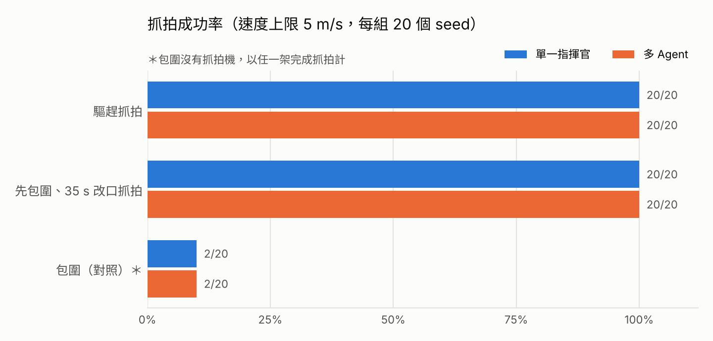
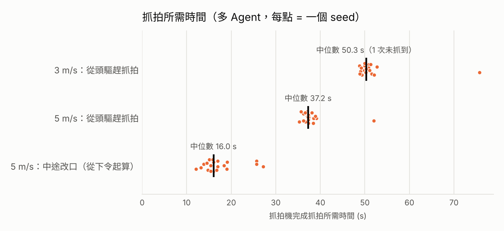

# 捕捉策略實驗結果（規則式 Agent）

程式版本 `adca345`；每個組合 20 個 seed（目標逃跑模型、起始位置、雜訊都由 seed 決定）。策略比較的無人機速度上限 5 m/s（對齊 A 的 agent_server --max-speed），目標是會逃的模擬目標（離最近無人機越近逃得越快，上限 2.2 m/s，半徑 60 m 圓形場地）。這是我們設計的簡化模型，不代表真實車輛或行人。

## 表 1：捕捉策略比較

| 策略 | 指揮架構 | 抓拍成功 | 抓拍時間 (s) | 中位數 (s) | 趕進捕捉區 | 視野內比例 | 最小水平距離 (m) | 最小 3D 距離 (m) | 指令一致率 | 動作到達率 |
|---|---|---|---|---|---|---|---|---|---|---|
| 驅趕抓拍（自主） | 單一指揮官 | 20/20（100%） | 38.0 ± 3.6 | 37.2 | 18/20（90%） | 84 ± 1% | 6.3（平均 7.8） | 8.6 | 86 ± 2% | 44 ± 8% |
| 驅趕抓拍（自主） | 多 Agent | 20/20（100%） | 37.9 ± 3.5 | 37.2 | 18/20（90%） | 84 ± 1% | 5.1（平均 7.9） | 7.1 | 85 ± 2% | 53 ± 12% |
| 驅趕抓拍（操作員下指令） | 單一指揮官 | 20/20（100%） | 38.0 ± 3.6 | 37.2 | 18/20（90%） | 84 ± 1% | 6.3（平均 7.8） | 8.6 | 86 ± 2% | 44 ± 8% |
| 驅趕抓拍（操作員下指令） | 多 Agent | 20/20（100%） | 37.9 ± 3.5 | 37.2 | 18/20（90%） | 84 ± 1% | 5.1（平均 7.9） | 7.1 | 85 ± 2% | 53 ± 12% |
| 包圍（對照） | 單一指揮官 | 2/20（10%）＊ | 37.2 ± 10.0 | 37.2 | —（無捕捉區） | 84 ± 1% | 4.4（平均 7.7） | 7.9 | 95 ± 1% | 50 ± 18% |
| 包圍（對照） | 多 Agent | 2/20（10%）＊ | 37.2 ± 10.0 | 37.2 | —（無捕捉區） | 84 ± 1% | 4.4（平均 7.7） | 7.9 | 95 ± 1% | 50 ± 18% |

＊包圍策略沒有抓拍機角色，這一欄是「任一架」完成抓拍判定（中央 20%、≥ 40 px、連續 2 s）的次數，只當參考。

## 表 1b：中途換策略（自然語言改口 → 重新分派角色）

| 指揮架構 | 次數 | 下令後完成抓拍 | 下令後抓拍時間 (s) | 中位數 (s) | 指令回應 (s) | 最小 3D 距離 (m) |
|---|---|---|---|---|---|---|
| 單一指揮官 | 20 | 20/20（100%） | 17.4 ± 4.1 | 16.2 | 0.10 ± 0.00 | 7.9 |
| 多 Agent | 20 | 20/20（100%） | 17.4 ± 4.2 | 16.0 | 0.10 ± 0.00 | 7.4 |

劇本 switch_capture：先包圍，第 35 秒操作員改口「改成把那台車趕進捕捉區抓拍」，150 s 內未抓拍算失敗。量的是「下令 → 協調 Agent 重新分派驅趕 / 抓拍 / 封鎖 → 抓拍機完成抓拍」的時間。

## 表 2：速度上限敏感度

| 速度上限 (m/s) | 策略 | 抓拍成功 | 抓拍時間 (s) | 趕進捕捉區 | 最小水平距離 (m) | 最小 3D 距離 (m) |
|---|---|---|---|---|---|---|
| 3 | 驅趕抓拍（自主） | 19/20（95%） | 51.7 ± 5.9 | 13/20（65%） | 3.9 | 6.3 |
| 3 | 包圍（對照） | 2/20（10%）＊ | 47.2 ± 10.0 | — | 7.1 | 8.7 |
| 5 | 驅趕抓拍（自主） | 20/20（100%） | 37.9 ± 3.5 | 18/20（90%） | 5.1 | 7.1 |
| 5 | 包圍（對照） | 2/20（10%）＊ | 37.2 ± 10.0 | — | 4.4 | 7.9 |

多 Agent（協調 Agent + 各機 Agent，規則式）。目標逃跑速度上限 2.2 m/s。三架分在 25 / 30 / 35 m 高度層，所以水平距離可以小於 5 m；安全要求看 3D 距離（規格：≥ 5 m）。

## 表 3：操作員指令劇本（指令理解與安全行為）

| 劇本 | 指揮架構 | 次數 | 計畫合法率 | 指令回應 (s) | 包圍完成 (s) | 恢復後重新包圍 (s) | 暫停期間自行出計畫 | 最小水平距離 (m) |
|---|---|---|---|---|---|---|---|---|
| 自主追蹤 | 單一指揮官 | 10 | 100 ± 0% | — | 29.9 ± 3.6 | — | 0 | 9.1 |
| 自主追蹤 | 多 Agent | 10 | 100 ± 0% | — | 29.9 ± 3.6 | — | 0 | 9.1 |
| 下指令包圍 | 單一指揮官 | 10 | 100 ± 0% | 0.10 ± 0.00 | 29.5 ± 3.8 | — | 0 | 9.4 |
| 下指令包圍 | 多 Agent | 10 | 100 ± 0% | 0.10 ± 0.00 | 29.5 ± 3.8 | — | 0 | 9.4 |
| 懸停後恢復 | 單一指揮官 | 10 | 100 ± 0% | 0.10 ± 0.00 | 29.5 ± 3.8 | 7.2 ± 5.4 | 0 | 11.4 |
| 懸停後恢復 | 多 Agent | 10 | 100 ± 0% | 0.10 ± 0.00 | 29.5 ± 3.8 | 6.7 ± 5.5 | 0 | 11.3 |
| 返航 | 單一指揮官 | 10 | 100 ± 0% | 0.10 ± 0.00 | 29.5 ± 3.8 | — | 0 | 11.4 |
| 返航 | 多 Agent | 10 | 100 ± 0% | 0.10 ± 0.00 | 29.5 ± 3.8 | — | 0 | 11.4 |

目標為不會反應的兔子路線（rabbit）；「暫停期間自行出計畫」應為 0（懸停 / 返航時 Agent 不能自己改計畫）。

## 圖

## 名詞

- **抓拍成功**：抓拍機畫面中，目標中心落在中央 20% × 20%、像素尺寸 ≥ 40 px，連續 2 s（規格 §10.10），用目標真值判定。
- **趕進捕捉區**：目標進入捕捉區（半徑 10 m）的比例；捕捉區由規劃器決定，同一次捕捉期間固定。
- **指令一致率**：無人機速度方向與「指向目標點」夾角 < 45°（或已到達）的時間比例，衡量飛控是否照指令飛。
- **動作到達率**：動作日誌中在期限內到達目標點的比例（規格 §10.11）；目標點跟著逃跑目標移動，所以低於指令一致率。
- **單一指揮官 / 多 Agent**：單一指揮官直接分派三架的角色；多 Agent 是協調 Agent 分派角色、每架各機 Agent 從角色白名單選動作。規則式的各機 Agent 選出的動作與單一指揮官的隱含動作幾乎相同，所以兩者數字很接近（包圍與兔子劇本完全相同）；差異要在 LLM 版本才看得出來（見 LLM 實測）。
- **重現**：`python -m demo.benchmark --scenario evader_capture evader_encircle command_capture --agents single multi --seeds 0 … 19 --drone-speed 5`；`--scenario evader_capture evader_encircle --agents multi --seeds 0 … 19 --drone-speed 3`；`--scenario switch_capture --agents single multi --seeds 0 … 19 --drone-speed 5`；`--scenario autonomous command_encircle hold_resume return_home --agents single multi --seeds 0 … 9`；再用 `python -m analysis.strategy_report --strategy … --speed … --switch … --operator …` 產生本檔。
- **command_capture 與 evader_capture 結果相同**：指令在第 10 秒、目標約第 18 秒才被發現，協調 Agent 記住操作員意圖，發現目標時直接進入驅趕抓拍，之後的過程與預設就是驅趕抓拍相同。中途換策略的能力看表 1b。
